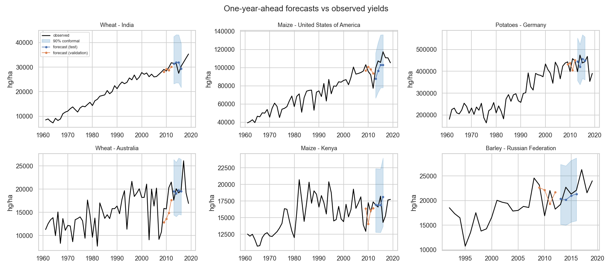

# PrediCrop: climate and agricultural yield forecasting

A reproducible machine-learning platform that forecasts national crop yields **one year ahead**
from historical FAO yield and pesticide statistics and monthly country climate records. It covers
data validation and integration, leakage-safe feature engineering, temporal cross-validation and tuning,
six benchmarked models, conformal prediction intervals, climate-sensitivity scenarios, SHAP / permutation
explanations, a six-page Streamlit app and a pytest suite.

All results quoted below were produced by the scripts in this repository on the four supplied CSV files.

## Headline results (full training mode, test years 2013-2016, 4,905 forecasts)

| Model | CV MAE (validation) | Test MAE | Test RMSE | Test R2 | Bias | Median APE | MAE of log yield | MASE |
|---|---|---|---|---|---|---|---|---|
| Naive (last value) | 9,570 | 10,660 | 29,786 | 0.935 | -818 | 5.26% | 0.118 | 1.216 |
| DummyRegressor (mean growth) | 9,662 | 10,717 | 29,997 | 0.935 | +391 | 5.18% | 0.118 | 1.222 |
| Linear Regression | 9,465 | 10,471 | 25,915 | 0.951 | -553 | 6.14% | 0.114 | 1.194 |
| **Random Forest (selected)** | **9,155** | **10,009** | 26,050 | 0.951 | -522 | 5.53% | **0.109** | **1.141** |
| XGBoost | 9,232 | 10,098 | 26,605 | 0.949 | -142 | 5.50% | 0.109 | 1.151 |
| LightGBM | 9,241 | 10,036 | 26,107 | 0.950 | -318 | 5.44% | 0.109 | 1.144 |

MAE, RMSE and bias are in hg/ha (10,000 hg/ha = 1 t/ha); bias > 0 means overprediction. Full table with training and
prediction times: [`reports/model_comparison.csv`](reports/model_comparison.csv).

What the results say:

* **Selection** was by expanding-window CV MAE on 1991-2012; Random Forest won and was evaluated once on 2013-2016.
  It reduces test MAE by 6.1% and RMSE by 12.5% relative to the naive "same as last year" forecast. All three tree
  ensembles are within 1% of each other.
* **Persistence is hard to beat.** The naive forecast has a lower *median* percentage error (5.26% vs 5.53%): the models
  win by partly anticipating rebounds after large shocks (year-on-year growth has lag-1 autocorrelation of -0.35), not
  by being better on every series. Long runs of identical FAO values favour persistence.
* **Climate and pesticides add little.** With the same algorithm and rows, yield history alone gives test MAE 10,055;
  adding lagged climate and pesticides gives 10,009 (-0.5%); adding *same-year* climate - information no real forecast
  has - gives 10,013. Country-level calendar-year climate is too coarse to carry much yield signal (see limitations).
* **Uncertainty.** Split-conformal 80% / 90% intervals (per-crop, calibrated on 2009-2012) covered 81.8% / 90.3% of test
  outcomes, and 82.8% / 90.5% in 2017, a year never used for anything. Per-year 90% coverage ranged 0.891-0.917; the
  lowest per-crop 80% coverage was 0.785 (potatoes). Median 90% interval width is 55% of the observed yield.
* **2017 check.** Trained on 1991-2012, the model's 2017 MAE is 8,881 hg/ha vs 9,188 for the naive forecast.
* **Explainability.** Permutation importance and SHAP agree that deviation from the 5-year mean and last year's
  growth dominate (mean reversion); in SHAP the lagged temperature anomaly is the largest climate contribution.
* **Associations (EDA).** In a first-difference panel regression with crop and year fixed effects, +10 percentage points
  of rainfall anomaly goes with +0.41% yield (95% CI +0.21 to +0.62) and +1 deg C with -0.68% (95% CI -1.47 to +0.11).
  These are associations, not causal effects.
* **Scenarios.** Median model responses are below 1% for all configured scenarios (-20% rainfall: -0.69%). Warming barely
  moves predictions because +1 deg C already takes 93% of series beyond their warmest observed year, where tree models
  cannot extrapolate. This is a limitation, not evidence that warming is harmless
  ([`reports/scenario_report.md`](reports/scenario_report.md)).

Reports: [data quality](reports/data_quality_report.md) | [EDA](reports/eda_report.md) |
[forecasting](reports/forecasting_report.md) | [scenarios](reports/scenario_report.md)




---

## 1. Research objectives

1. Forecast next year's yield of a known (country, crop) series using only information available before that year.
2. Quantify how much lagged climate and pesticide information adds over yield history alone.
3. Give honest forecast uncertainty (prediction intervals whose coverage is checked on unseen years).
4. Separately, describe how yields **co-vary** with same-year rainfall and temperature, and how the model responds to
   hypothetical climate changes, without presenting either as causal climate impacts.

**Forecasting vs relationship estimation.** The benchmark models answer "what will the yield be next year?" with
information known at the start of that year. The EDA panel regression and the scenario model answer a different
question: "how does yield (or the model) co-vary with *same-year* climate?" Same-year climate is not known when a
forecast is issued, so it is never used by the forecasting models.

## 2. Datasets

| file | rows | content | unit | coverage |
|---|---|---|---|---|
| `yield.csv` | 63,691 | FAO crop yield by country x crop x year (Element = *Yield*) | hg/ha | 1961-2019, 203 areas, 14 crops |
| `pesticides.csv` | 4,789 | FAO *Pesticides (total)*, agricultural use, national | tonnes | 1990-2018, 172 areas |
| `rainfall.csv` | 272,832 | monthly country precipitation | mm | 1901-2016, 196 countries |
| `temp.csv` | 272,832 | monthly country mean temperature | deg C | 1901-2016, 196 countries |

Key facts established by inspection (`reports/data_quality_report.md`):

* The target is unambiguous: `Element` is always *Yield* and `Unit` always *hg/ha* (10,000 hg/ha = 1 t/ha). It is
  yield per harvested hectare, not production. Units are kept as supplied.
* No raw file has missing cells or duplicate keys. Five yields are exactly zero (removed); 198 runs of >= 5 identical
  consecutive yields (likely FAO estimates) and 88 >5x year-on-year jumps are flagged but kept.
* There is no sub-national geography and no crop dimension in the climate or pesticide files: the finest common
  resolution is **country x calendar year**.
* Pesticides are national totals for all crops in tonnes - not per hectare and not crop-specific.
* Climate is monthly; there is no daily data and no min/max temperature, only monthly means.

The full data dictionary is in [`data/README.md`](data/README.md); engineered features are documented in
`FEATURE_DOCS` in [`src/climate_yield/feature_engineering.py`](src/climate_yield/feature_engineering.py).

## 3. Data integration strategy

* **Join keys:** yield `(Area, Item, Year)` is the target table. Pesticides join many-to-one on `(area, year)`
  (same FAO naming). Climate joins many-to-one on `(area, year)` after mapping 28 World Bank country names to FAO
  names (`COUNTRY_NAME_MAP`, every entry hand-checked; a test asserts every mapped name exists in both files and the
  mapping is one-to-one). Joins use `validate="m:1"` and assert that the row count is unchanged.
* **Aggregation:** monthly rainfall is accumulated precipitation, so annual totals are **sums** (plus wettest/driest
  month). Temperature is a monthly mean, so it is **averaged** (plus warmest/coldest monthly mean). Country-years
  without all 12 months are dropped. No crop calendars are available, so climate is aggregated by calendar year
  rather than by growing season - a documented limitation.
* **Anomalies:** rainfall (%) and temperature (deg C) anomalies are relative to each country's 1901-1960 mean,
  a window that ends before every modelling target year.
* **Exclusions:** the FAO aggregate `China` (it double-counts mainland/Taiwan/Hong Kong/Macao; World Bank `China` is
  matched to `China, mainland`); 17 FAO areas with no climate series (USSR, Yugoslav SFR, Czechoslovakia, Ethiopia PDR,
  Sudan (former), Belgium-Luxembourg, Serbia and Montenegro, Taiwan, Hong Kong, Palestine, several territories).
* **Result:** 59,170 integrated yield records, 1,269 (country, crop) series, 185 countries. 28 yield countries have no
  pesticide data; those values are imputed inside the model pipelines. Full report: `data/processed/integration_report.json`
  (regenerated) and the integration section of `reports/data_quality_report.md`.

## 4. Forecasting task and validation

* **Target:** yield (hg/ha) of a known (country, crop) series in year *t*. Models predict log growth
  `log(y_t / y_{t-1})`; the forecast is `y_{t-1} * exp(prediction)`.
* **Horizon:** one year. Features use yields up to *t-1*, climate of calendar year *t-1*, pesticides of *t-1*.
* **Benchmark rows:** target years 1991-2016 (1991 = first year with lag-1 pesticides, 2016 = last climate year),
  30,170 rows, identical for every model.
* **Partitions:** train 1991-2008, validation 2009-2012, test 2013-2016 (untouched until the end).
* **Tuning:** random search (6 candidates in quick mode, 15 in full mode) scored by mean MAE over four
  expanding-window folds validating on 2005-06, 2007-08, 2009-10 and 2011-12; each fold trains on earlier years only.
* **Selection:** lowest mean CV MAE. The selected configuration is refitted on 1991-2012 and evaluated once on 2013-2016.

### Leakage controls (all covered by tests)

* Lags are calendar-aligned within each (country, crop) series; a missing year gives NaN, never the previous row or
  another series' value.
* Rolling statistics are trailing windows over *t-k..t-1* (never centred); a test changes yields in year *t* and later
  and checks that features at *t* are unchanged.
* Same-year climate appears only in the separately labelled `conditional` feature set used for scenarios.
* Imputers, scalers and encoders are fitted inside each pipeline on training folds only (tested).
* Conformal intervals are calibrated on 2009-2012 residuals, never on test labels.

### Engineered features

| group | features | available at forecast time? |
|---|---|---|
| yield history | log yield at t-1, t-2, t-3; growth t-2 -> t-1; trailing 3- and 5-year mean of log yield; 5-year std; deviation from 5-year mean; 4-year trend; number of prior observations | yes |
| lagged climate | t-1 annual rainfall, wettest/driest month, mean/warmest/coldest-month temperature, rainfall and temperature anomalies; static 1901-1960 country climatology | yes |
| lagged pesticides | log(1 + national tonnes) at t-1, log change t-2 -> t-1 | yes, assuming the t-1 statistic is published in time (FAO releases with a lag) |
| crop | one-hot crop | yes |
| same-year climate (`conditional` only) | year-t rainfall/temperature statistics, anomalies, rainfall x temperature anomaly | **no** - scenario use only |

## 5. Installation (Windows PowerShell)

Python 3.10+ (developed with Python 3.13 on Windows 11, CPU only).

```powershell
git clone https://github.com/Andrew123s/predicrop.git
cd predicrop
python -m venv .venv
.\.venv\Scripts\Activate.ps1
python -m pip install --upgrade pip
pip install -r requirements.txt
pip install -e . --no-deps
```

The four CSVs are expected at the repository root (they are included).

## 6. Reproducing the results

```powershell
python scripts\inspect_data.py                # data-quality report        -> reports\data_quality_report.md
python scripts\run_eda.py                     # integration, features, EDA -> reports\eda_report.md, figures
python scripts\train_models.py --mode quick   # fast run (~11 min on a laptop CPU)
python scripts\train_models.py --mode full    # final run used for the results (~27 min)
python scripts\generate_forecasts.py          # next-year forecasts + 2017 backtest
python scripts\generate_reports.py            # scenarios + forecasting/scenario reports
python -m pytest                              # tests
streamlit run app\streamlit_app.py            # app at http://localhost:8501
```

`train_models.py` stores a fingerprint of the raw data, configuration, source code and mode in `models/fingerprint.json`
and skips retraining when nothing has changed (`--force` overrides). Both modes use the same temporal validation;
`full` only searches more configurations with more trees. Settings live in `config/config.yaml`.

Notebooks in `notebooks/` (`01_data_inspection`, `02_exploratory_analysis`, `03_forecasting`) read the saved outputs and
models; they do not retrain anything.

## 7. Streamlit application

`streamlit run app\streamlit_app.py` opens six pages backed by the real data and the saved models (nothing is trained
at start-up; data preparation and model loading are cached):

1. **Overview** - objectives, dataset summary, coverage, crops, target and unit, horizon, split, saved models, feature dictionary.
2. **Data explorer** - yield trends by crop and country, crop comparison, annual climate series, pesticide series,
   relationship scatter plots with Spearman correlation, missing-data summary.
3. **Model benchmarking** - comparison table, information-set ablation, actual vs predicted, residual diagnostics,
   error by year, metrics by crop, example series.
4. **Yield forecasting** - choose crop, country and year: genuine next-year forecast (history-only model) or a backtest
   with the climate & pesticide model, with 80%/90% conformal intervals, the inputs used and warnings (short
   history, flat FAO runs, imputed inputs). No future climate is requested, because it is unknown at forecast time.
5. **Climate scenarios** - rainfall (+/-50%) and temperature (+/-5 deg C) sliders applied to a 2016 baseline, with
   extrapolation and historical-analogue warnings and the crop's interval width for context.
6. **Explainability** - permutation importance, SHAP summaries, a per-row SHAP explanation and interpretation limits.

Missing artifacts or data files produce an error message on the page instead of a crash.

## 8. Project structure

```
config/config.yaml           all paths, split years, CV folds, search sizes, scenario magnitudes
src/climate_yield/
  config.py                  configuration and paths
  data_loader.py             raw CSV loading and tidy renaming
  data_validation.py         schema checks, profiles, flat-run / jump detection
  data_integration.py        name harmonisation, climate aggregation, many-to-one joins with row-count checks
  feature_engineering.py     calendar-aligned lags, trailing windows, climate/pesticide lags, feature sets
  pipeline.py                end-to-end preparation and the retraining fingerprint
  exploratory_analysis.py    EDA figures and the first-difference climate association model
  temporal_validation.py     chronological split and expanding-window folds
  train.py                   model definitions, pipelines and time-aware random search
  evaluate.py                MAE, RMSE, R2, bias, MAPE / median APE, MASE, log MAE
  uncertainty.py             split-conformal (pooled and per-crop) intervals and coverage
  scenarios.py               scenario validation, perturbation, extrapolation and analogue checks
  explainability.py          permutation importance and SHAP
  benchmark.py               orchestration of tuning, evaluation, uncertainty, explanations, deployment models
  predict.py                 validated loading and forecasting from saved bundles
  reporting.py               figures and Markdown tables
scripts/                     inspect_data, run_eda, train_models, generate_forecasts, generate_reports
app/streamlit_app.py         six-page app
tests/                       pytest suite (synthetic fixtures + real-data schema / join checks)
models/                      saved model bundles (benchmark/ and deploy/)
reports/                     reports, CSV results and figures
notebooks/                   executed walkthrough notebooks
```

## 9. Known limitations

* **Spatial and temporal resolution.** Country-average, calendar-year climate mixes growing and non-growing seasons,
  irrigated and rain-fed areas, and cropping and non-cropping regions. It is a weak proxy for crop weather, which
  pushes estimated climate effects towards zero.
* **No crop calendars**, so no growing-season aggregation; northern- and southern-hemisphere seasons are treated alike.
* **Pesticides** are national totals for all crops; they say nothing about application rates on a given crop, and
  the t-1 value may not be published in time for a real forecast.
* **Data quality.** FAO figures include estimates (long flat runs) and some implausible jumps; they are kept because
  there is no defensible way to correct them, and they dominate the largest errors.
* **Horizon.** Climate ends in 2016 and pesticides in 2018, so the only genuinely future forecast (for the year after
  the last observed yield) uses yield history alone.
* **Conformal intervals** assume calibration and future errors are exchangeable; this holds only approximately under
  temporal drift, and coverage is checked per year and per crop rather than assumed.
* **Scenarios** are model sensitivities, not projections: no CO2, seasonality, extremes, pests or adaptation.
  Recent years are already the warmest on record for most countries, so warming scenarios are extrapolation.
* **Scope.** Forecasts are for known (country, crop) series only; new countries or crops are not supported.

## 10. Future improvements

* Growing-season climate from crop calendars (e.g. MIRCA/SAGE) and cropland-weighted gridded weather.
* Daily extremes (heat days, dry spells) and soil-moisture indices.
* Hierarchical / mixed-effects models sharing strength across countries; quantile models for asymmetric errors.
* Adaptive conformal methods for drifting time series; per-country calibration where data allow.
* Robust handling of FAO estimate flags (requires the FAOSTAT flag column, absent from these files).

## 11. Data attribution and licensing

The supplied files carry no metadata about their origin. Their structure matches public sources:

* `yield.csv`, `pesticides.csv`: FAOSTAT (Food and Agriculture Organization of the United Nations), domains
  *Crops* and *Pesticides Use*. FAOSTAT data are published under CC BY 4.0 (older releases under CC BY-NC-SA 3.0 IGO).
* `rainfall.csv`, `temp.csv`: country-level monthly series in the format of the World Bank Climate Change Knowledge
  Portal (CC BY 4.0).

These files are widely redistributed together as a public "crop yield prediction" dataset. Please cite the original
providers and check their current terms before reuse. The code in this repository is released under the MIT licence
(see `LICENSE`).
